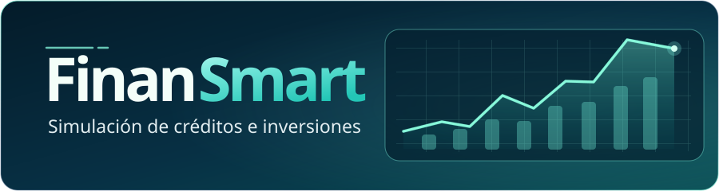
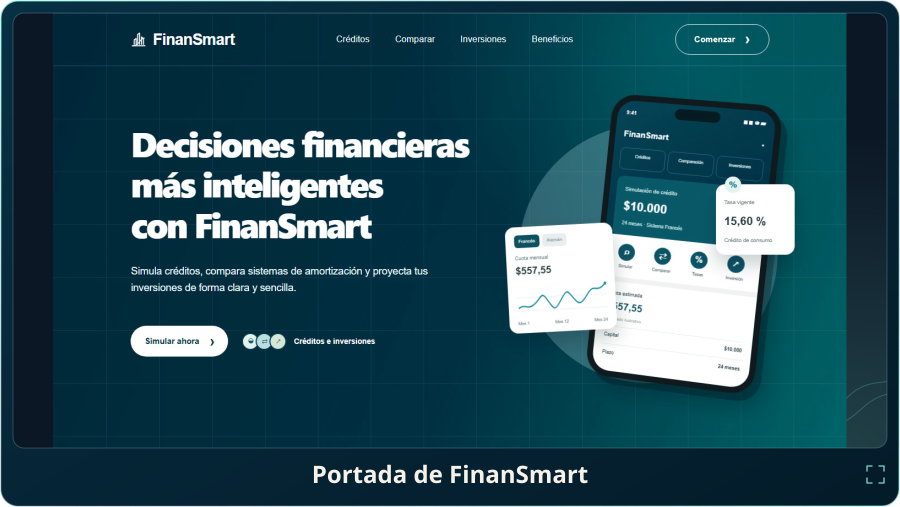
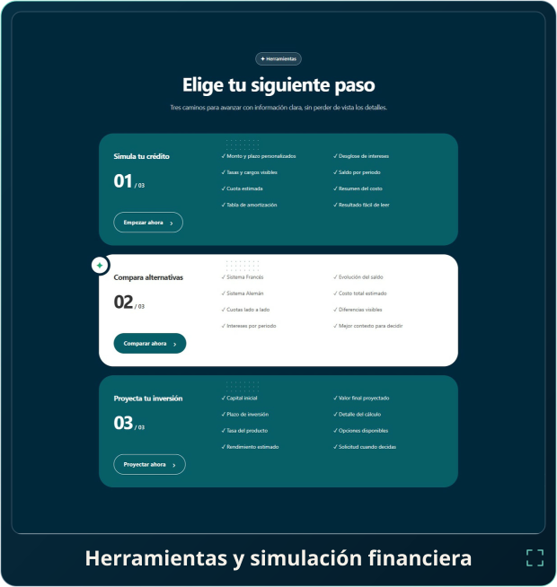
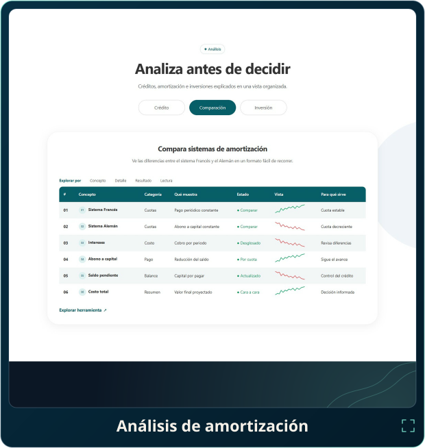

<p align="center">
  <picture>
    <source media="(prefers-reduced-motion: no-preference)" srcset="./docs/assets/banner-motion.svg">
    
  </picture>
</p>

<p align="center">
  <a href="#funcionalidades">Funcionalidades</a> · <a href="#tecnologías">Tecnologías</a> · <a href="#ejecutar-en-local">Ejecutar en local</a> · <a href="#capturas">Capturas</a>
</p>

Plataforma para explorar créditos e inversiones antes de iniciar una solicitud. Compara amortizaciones, visualiza el detalle de las cuotas y conserva una copia de la proyección en PDF.

## Funcionalidades

- **Simulación de créditos.** Calcula la tabla de amortización francesa o alemana y compara los resultados.
- **Evaluación de inversiones.** Proyecta una inversión con sus condiciones, inicia una solicitud y consulta su estado.
- **Área de administración.** Mantiene productos, tasas y la identidad visual de la institución.
- **Validación de identidad.** Incorpora documentos de la solicitud y comprobaciones de identidad en el flujo de inversión.

## Tecnologías

| Tecnología | Uso |
| --- | --- |
| Angular 20, TypeScript y RxJS | Interfaz pública, simuladores y paneles |
| C# y ASP.NET Core 9 | API REST, cálculo financiero y reglas de negocio |
| PostgreSQL, EF Core 9 y Npgsql | Datos de clientes, catálogos, solicitudes y migraciones |
| JWT | Sesiones para clientes y administración |
| QuestPDF | Exportación de resultados |
| Azure Document Intelligence y MediaPipe | Lectura documental y procesamiento de imagen para identidad |

## Ejecutar en local

Prepara **.NET SDK 9**, **Node.js 24 con npm** y una instancia de **PostgreSQL** para desarrollo.

### Configurar y arrancar la API

Desde la raíz del repositorio, copia la plantilla local si todavía no tienes una configuración.

```powershell
$config = 'backend/FinanSmart.Api/appsettings.Development.json'
if (-not (Test-Path $config)) {
    Copy-Item 'backend/FinanSmart.Api/appsettings.Development.example.json' $config
}
```

Completa `ConnectionStrings:DefaultConnection` y `Jwt:Key` en el archivo local. Conserva las credenciales fuera del repositorio. Para probar la revisión documental, configura `AzureDocumentIntelligence:Endpoint` y `AzureDocumentIntelligence:Key`. El umbral de confianza se ajusta en las [opciones de validación documental](backend/FinanSmart.Api/Modules/Investments/Documents/DocumentValidationOptions.cs).

Si aún no tienes el CLI de Entity Framework Core 9, instálalo con `dotnet tool install --global dotnet-ef --version 9.0.4`. Luego aplica las migraciones y levanta la API.

```powershell
dotnet ef database update --project backend/FinanSmart.Api
dotnet run --project backend/FinanSmart.Api --launch-profile http
```

La API escucha en [localhost:5246](http://localhost:5246/openapi/v1.json). El enlace abre la especificación OpenAPI.

### Iniciar la interfaz

En otra terminal desde la raíz del repositorio, usa el script local de Angular.

```bash
cd frontend
npm ci
npm start
```

Abre [localhost:4200](http://localhost:4200). El [entorno de desarrollo](frontend/src/environments/environment.ts) apunta a la API local. La compilación de producción usa rutas relativas al mismo origen.

## Estructura

- [`frontend/src/`](frontend/src) contiene las páginas, componentes y servicios web.
- [`FinanSmart.Api/`](backend/FinanSmart.Api) es el proyecto de API ASP.NET Core.
- [`Modules/`](backend/FinanSmart.Api/Modules) agrupa autenticación, créditos, inversiones y administración.
- [`Data/Migrations/`](backend/FinanSmart.Api/Data/Migrations) contiene las migraciones de PostgreSQL.

## Comprobaciones

- En la raíz, `dotnet build backend/FinanSmart.sln` compila la API.
- En `frontend/`, `npm test` ejecuta las pruebas de Angular y `npm run build` genera la aplicación.

## Capturas

<p align="center">
  <a href="./docs/assets/capturas/finansmart.png"></a>
</p>

<p align="center">
  <a href="./docs/assets/capturas/finansmart-herramientas.jpg"></a>
  <a href="./docs/assets/capturas/finansmart-analisis.jpg"></a>
</p>
